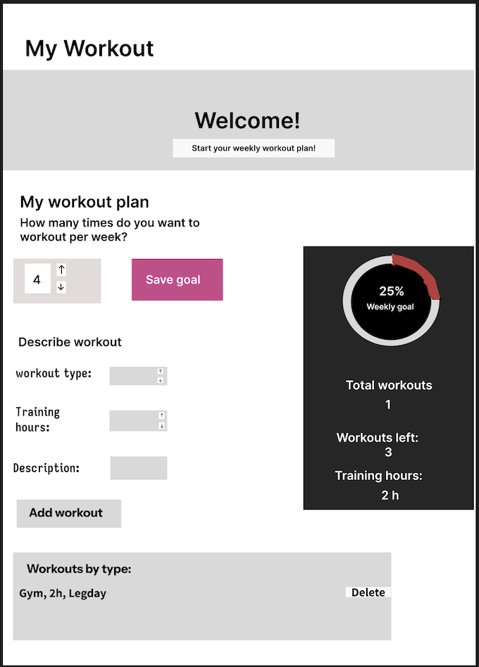
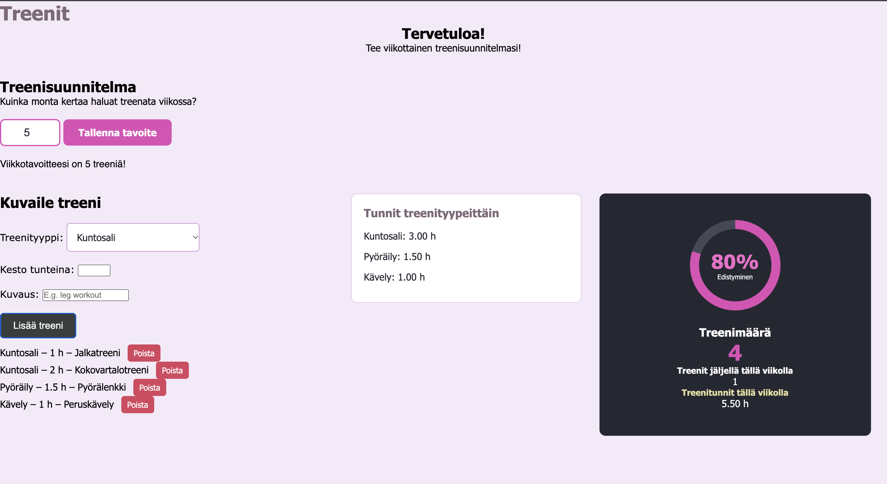

# OmaTreeni

**Tekijä(t):** Silja Jahnukainen

## Projektisuunnitelma

### Projektin idea

Käyttäjä voi seuraa sovelluksella omia treenikertoja ja pitää yllä treenitavoitteita sekä pysyä niissä ajan tasalla. Sovellus on tarkoitettu kaikille, jotka haluavat seurata omaa treeniä ja treenata säännöllisesti kuntosalin, pyöräilyn, juoksun tai muun liikunnan muodossa.

### Suunnitellut toiminnot

Suunnitellut toiminnot:

- Käyttäjä voi asettaa itselleen treenitavoitteen viikoittain
- Käyttäjä voi kirjata uuden treenin, kuvauksen ja keston
- Laskuri pitää kirjaa, montako treenikertaa käyttäjä on tehnyt ja kuinka monta on jäljellä.
- Laskuri seuraa treenituntien kokonaismäärää

### Rautalankamalli / luonnos

-Huom! Rautalankamalli on tehty englanniksi, mutta päätinkin tehdä lopullisen sovelluksen suomeksi.

## Verkkolinkit

- **Julkaistu sovellus:** [Avaa OmaTreeni](https://siljah18.github.io/Projekti-DOM-skriptaus/)
- **GitHub-repositorio:** [Lisää tähän repositorion osoite](https://github.com/yourusername/your-repository)
- **Projektin videoesittely:** [Lisää tähän videon osoite](https://example.com/)

## Tietoja sovelluksesta

**[OmaTreeni]** on verkkosovellus, joka seuraa käyttäjän asettamia treenejä ja vertaa niitä asetettuun viikottaiseen treenitavoitteeseen. 

Verkkosovelluksen tarkoitus on auttaa käyttäjää seuraamaan omaa liikuntaansa ja asettamaan itselleen tavoitteita, joita pyrkii saavutttamaan. Sovelluksen avulla Käyttäjä voi helpottaa treenin suunnittelua ja edistymisen seuraamista. Näin myös käyttäjän motivaatio voi kasvaa.

Tärkeimmät toiminnot:
- Käyttäjä voi asettaa viikoittaisen tavoitteen
- Käyttäjä voi lisätä treenin, kuvauksen ja keston
- Käyttäjä voi seurata mitä treenejä on tehnyt aikaisemmin viikolla 
- Sovellus seuraa tavoitteen edistymistä ja näyttää jäljellä olevat  treenikerrat

## Teknologiat

Käytin HTML:ää sivun rakenteen tekemiseen, CSS:ää hienon ulkoasun toteuttamiseen. JavaScriptiä käytin toimintojen toimivuuden mahdollistamiseen. Lisäksi se mahdollisti treenien päivittämisen sekä lomakkeen tietojen tarkistamisen. LocalStoragea käytin tietojen tallentamiseen selaimessa, jotta ne eivät häviä esimerkiksi silloin, kun päivittää sivun.

## Sovelluksen käyttö

Käyttöohjeet OmaTreeni -sovellukselle.

1. Avaa julkaistu sovellus yllä olevasta linkistä.
2. Aseta treenitavoitteesi viikolle.
3. Lisää treeni täyttämällä lomakkeen kentät.
4. Poista treeni tarvittessa.
5. Seuraa treenien määrää, tuntimäärää ja tavoitteesi edistymistä.
4. Päivitä sivu ja tarkista, säilyvätkö tiedot selaimessa.

## Sovelluksen käynnistäminen paikallisesti

1. Kloonaa tai lataa tämä repositorio omalle koneellesi.
2. Avaa projektikansio.
3. Avaa `index.html` selaimessa.

## Kuvakaappaukset

## Tunnetut virheet / puutteet

Sovelluksen mahdollinen oleellinen puute on, että sovellus laskee kaikki käyttäjän laittamat treenit, eikä tiedä milloin treenit on tehty. Se ei siis erota treenejä aikaisempien viikkojen treeneistä. Käyttäjän itse nollaa treenit treeniviikon loputtua.

## Oma arvio ja oppimisen reflektointi

Onnistuin tekemään oikeat koodit projektin toimimisen saavuttamiseksi. Haastavaa oli laskurin tekeminen ja sen toiminnan ymmärtäminen. Jos aikaa olisi enemmän, tekisin sovellukseen lisää toimintoja, jotka parantavat sitä. Lisäisin treeneille päivämäärät, jotta sovellus voi erottaa eri viikkojen treenit ja seurata oikeaa viikon edistymistä. 

Opin paljon lisää JavaScriptistä ja sen toiminnoista sekä miten voin hyödyntää DOM-skriptausta sovelluksessa. HTML ja CSS olivat minulle jo tutumpia, joten pääsin hyödyntämään vähän omaa osaamista verkkosivun rakenteeseen ja ulkoasuun liittyen.

Haluaisin oppia ymmärtämään lisää erilaisia koodin käskyjä ja hahmottamaan, missä tilanteissa niitä käytetään. Oma arvio tästä projektista on 9/10 pistettä, sillä onnistuin tekemään toimivan sovelluksen ja täytin mielestäni kaikki kriteerit.

## Lähteet ja kiitokset

Listaa kaikki projektissa käyttämäsi lähteet, tutoriaalit, kuvat ja koodiesimerkit.

Jos käytit ChatGPT:tä, GitHub Copilotia tai muuta tekoälytyökalua, mainitse se tässä ja kerro lyhyesti, miten se tuki työskentelyäsi.

- [HTML select element](https://developer.mozilla.org/en-US/docs/Web/HTML/Reference/Elements/select)
- [Expressions and operators](https://developer.mozilla.org/en-US/docs/Web/JavaScript/Guide/Expressions_and_operators)
- Käytetty tekoälytyökalu: ChatGPT
  - Miten työkalua käytettiin: Käytettiin koodin toiminnan ymmärtämiseen ja joidenkin JavaScript -toimintojen luomiseen sekä koodin virheiden etsimiseen. 

  ## Lisenssi

Tämä projekti on lisensoitu MIT-lisenssillä.
Lisätietoa lisenssin lisäämisestä GitHub-projektiin:
https://docs.github.com/en/communities/setting-up-your-project-for-healthy-contributions/adding-a-license-to-a-repository
=======

